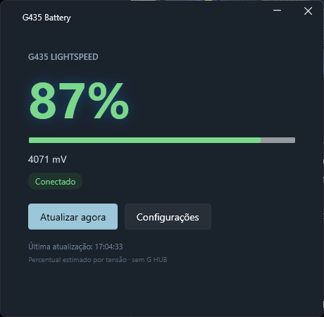

# G435 Monitor

Aplicativo independente para Windows 11 que mostra a bateria do
**Logitech G435 LIGHTSPEED** sem G HUB.



## Recursos

- Leitura da bateria pelo dongle LIGHTSPEED (`046D:0ADF`, interface HID `MI_00`).
- Percentual com histerese de 2%, tensão em mV e estado **Conectado/Desconectado**.
- Ícone de bandeja dinâmico: bateria com preenchimento proporcional e cores por
  nível (vermelho ≤10%, âmbar 11–39%, verde ≥40%).
- Bandeja, instância única, iniciar com o Windows e intervalo de
  5/10/15/30 minutos.
- Sem G HUB, sem telemetria e sem acesso à rede.
- **Não exibe estado de carga**: o G435 não expõe um flag confiável no
  protocolo testado. O percentual é mantido estável quando há indício de
  subida de tensão, para evitar o salto 70→100 durante a carga.

## Requisitos

- Windows 11 x64.
- [.NET 8 Desktop Runtime](https://dotnet.microsoft.com/download/dotnet/8.0)
  para o ZIP da release, ou .NET 8 SDK para compilar.

## Baixar e executar

1. Baixe o ZIP em [Releases](../../releases/latest).
2. Extraia e execute `G435Monitor.exe`.
3. Fechar a janela minimiza para a bandeja. Use o menu da bandeja para sair.

## Compilar

```powershell
dotnet build src/G435Monitor -c Release
```

O executável fica em
`src/G435Monitor/bin/Release/net8.0-windows/G435Monitor.exe`.

## Como funciona

O dongle expõe uma interface HID de fornecedor (`usage page 0xFF00`, relatórios
de 65 bytes). O app usa a sequência validada:

`0x85 01` → `GET_MODE` → `SET_MODE 1` → `GET_BATTERY (0x31)` →
`SET_MODE 0` → `0x85 02`.

A tensão é convertida em percentual por uma curva de descarga. Nenhum comando
de OTA/DFU é usado.

## Limitações

- A porcentagem é uma **estimativa por tensão**, não um fuel gauge; pode
  variar alguns pontos.
- Funciona somente com o G435 LIGHTSPEED (`046D:0ADF`); não abre outros
  dispositivos Logitech.
- O estado de carga (carregando/não carregando) não é exibido porque não foi
  confirmado no hardware. Testes com o comando `0xE6` e capturas passivas não
  forneceram um bit confiável.
- Feche programas que disputem a interface HID se a leitura falhar.

## Privacidade

O app não coleta dados, não acessa a rede e não requer conta.

## Créditos

Protocolo e ideias estudados a partir de projetos MIT:

- [deddroid/logitech-g435-battery](https://github.com/deddroid/logitech-g435-battery)
- [DsGrilo/G435-Battery-app](https://github.com/DsGrilo/G435-Battery-app)
- [portyporty/g435-battery-percentage](https://github.com/portyporty/g435-battery-percentage)
- [morluto/rea](https://github.com/morluto/rea)
- [jenesei-software/gearhub](https://github.com/jenesei-software/gearhub)

Interface construída com [WPF-UI](https://github.com/lepoco/wpfui) (MIT).
Licenças e avisos de terceiros: [THIRD-PARTY-NOTICES.md](THIRD-PARTY-NOTICES.md).

## Aviso

Projeto não oficial, sem vínculo com a Logitech. Logitech, G435 e LIGHTSPEED
são marcas da Logitech.

## Licença

MIT — veja [LICENSE](LICENSE).
